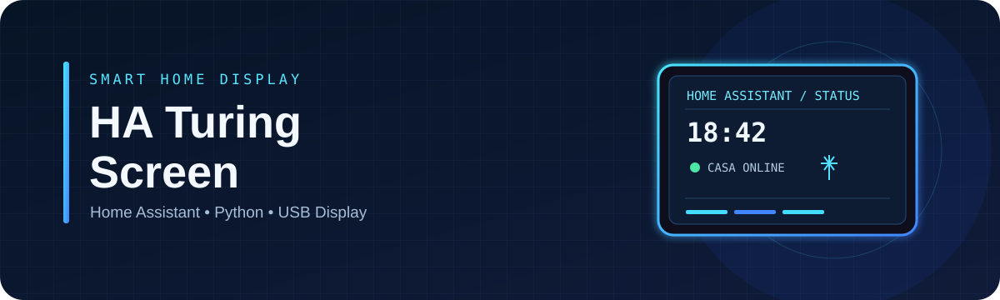
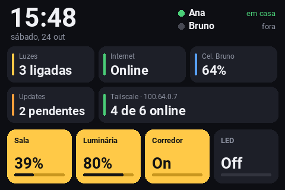
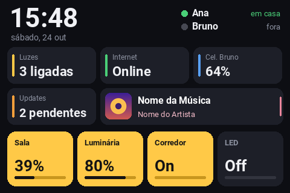
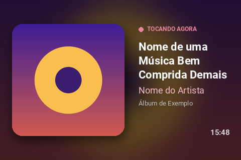

<div align="center">
  

  <h1>HA Turing Screen</h1>
  <p><strong>Seu Home Assistant, direto na tela Turing Smart Screen 3.5”.</strong></p>
  <p>Um painel compacto em Python com estado da casa, luzes, bateria, conectividade, Tailscale e mini-player de música.</p>

  
  
  
  
</div>

---

## ✨ Visão geral

O **HA Turing Screen** transforma uma tela USB Turing Smart Screen 3.5" (ou XuanFang 3.5") em um pequeno painel para acompanhar informações importantes da sua casa inteligente.

| Painel de status | Mini-player | Player em tela cheia |
|:---:|:---:|:---:|
|  |  |  |
| Estado da casa e Tailscale | Música, artista e capa | Capa e informações da faixa |

## 🚀 Funcionalidades

- **Home Assistant:** consulta estados por meio da API REST.
- **Status da casa:** hora, pessoas em casa, luzes, internet, bateria do celular e atualizações pendentes — conforme as entidades configuradas.
- **Spotify e media players:** exibe capa, música e artista quando o player escolhido está tocando.
- **Dois modos de player:** `mini` e `tela_cheia`.
- **Tailscale:** mostra o IP e a quantidade de dispositivos online quando não há música tocando.
- **Atualização inteligente:** evita reenviar a imagem à tela quando o conteúdo não mudou.
- **Pré-visualização:** gera imagens de exemplo com `--preview`, sem precisar conectar a tela.
- **Configuração externa:** credenciais e entidades ficam em `ha_screen.ini`, ignorado pelo Git.
- **Controles no Home Assistant Core:** package YAML para ligar/desligar a tela, ajustar o brilho, alternar o fundo de fotos e entrar no modo descanso.
- **Fotos e modo descanso:** slideshow como papel de parede e tela ociosa com foto nítida, relógio e data.
- **Notificações:** automações podem enviar avisos personalizados; dispositivos configurados também geram alertas discretos quando ficam indisponíveis.

## 🏠 Integração Home Assistant Core

Instale o package [`turing_screen.yaml`](turing_screen.yaml) e siga o [guia de instalação e notificações](INSTALAR_CONTROLES_HA.md). Para adicionar somente os controles à sua dashboard existente, use o [exemplo de cartão Lovelace](docs/examples/dashboard-card-tela-turing.yaml); ele não substitui a sua dashboard completa.

## 🧰 Requisitos

- Windows e Python **3.10 ou superior**.
- Turing Smart Screen 3.5" Rev. A ou XuanFang 3.5" Rev. B, conectada por USB.
- Home Assistant acessível pela rede local, VPN ou Tailscale.
- Repositório de comunicação da tela: [`turing-smart-screen-python`](https://github.com/mathoudebine/turing-smart-screen-python).

## 📦 Instalação

### 1. Baixe os projetos

Baixe este repositório e extraia-o. Baixe também o projeto [`turing-smart-screen-python`](https://github.com/mathoudebine/turing-smart-screen-python) e extraia-o, por exemplo, em `C:\tela\turing-smart-screen-python-main`.

### 2. Instale as dependências deste projeto

Abra o Prompt de Comando na pasta deste repositório:

```bat
python -m pip install -r requirements.txt
```

> **Importante:** use o `requirements.txt` deste repositório para instalar as dependências do painel. Não substitua pelo arquivo do projeto original da tela.

### 3. Crie a configuração local

```bat
copy ha_screen.example.ini ha_screen.ini
notepad ha_screen.ini
```

Edite `ha_screen.ini` com os dados da sua instalação. **Não compartilhe esse arquivo:** ele pode conter seu token de acesso ao Home Assistant.

| Configuração | Descrição | Exemplo |
|---|---|---|
| `[ha] url` | URL do Home Assistant | `http://homeassistant.local:8123` |
| `[ha] token` | Token de acesso de longa duração | `COLE_SEU_TOKEN_AQUI` |
| `[tela] projeto` | Pasta do projeto de comunicação da tela | `C:\tela\turing-smart-screen-python-main` |
| `[tela] porta` | Porta serial da tela ou detecção automática | `COM3` ou `AUTO` |
| `[tela] revisao` | Revisão do hardware | `A` ou `B` |
| `[tela] brilho` | Brilho entre 0 e 100 | `30` |
| `[player] entidade` | Entidade `media_player` a exibir | `media_player.spotify_seu_usuario` |
| `[player] modo` | Layout do player | `mini` ou `tela_cheia` |
| `[tailscale] ativar` | Exibir status do Tailscale | `sim` ou `nao` |

Na seção `[entidades]`, informe os IDs que deseja exibir. Câmeras podem ser configuradas em `cameras` e, opcionalmente, seus switches de privacidade em `camera_privacidade`; consulte o exemplo de INI. Na seção `[luzes]`, configure até quatro entidades `light.*` ou `switch.*` e seus nomes de exibição. Substitua os exemplos pelos IDs da sua instalação somente no `ha_screen.ini` local.

Para criar um token, abra seu perfil no Home Assistant e procure **Tokens de acesso de longa duração** nas opções de segurança.

### 4. Execute o painel

```bat
python ha_screen.py
```

Para gerar imagens de demonstração sem a tela conectada:

```bat
python ha_screen.py --preview
```

Para usar outro arquivo de configuração:

```bat
python ha_screen.py --config caminho\para\config.ini
```

**Antes de executar:** feche outros programas que estejam usando a tela, incluindo o utilitário do fabricante. A porta COM geralmente só pode ser usada por um programa de cada vez.

## 🪟 Iniciar automaticamente com o Windows

É possível iniciar o script sem abrir uma janela de terminal usando o Agendador de Tarefas:

1. Abra **Agendador de Tarefas** e selecione **Criar Tarefa**.
2. Em **Disparadores**, crie um disparador **Ao fazer logon**.
3. Em **Ações**, selecione **Iniciar um programa**.
4. Em **Programa/script**, informe o caminho completo para `pythonw.exe` (normalmente dentro da instalação do Python).
5. Em **Adicionar argumentos**, informe o caminho completo para `ha_screen.py`.
6. Em **Iniciar em**, informe a pasta do projeto.
7. Salve e teste a tarefa. Se necessário, execute primeiro com `python ha_screen.py` para conferir os erros.

> Dica: `pythonw.exe` não exibe o terminal. Durante o diagnóstico, prefira `python.exe` para conseguir ler as mensagens de erro.

## 🛠️ Solução de problemas

| Problema | O que verificar |
|---|---|
| `Cannot find command 'git'` ou dependências inesperadas | Confirme que instalou o `requirements.txt` deste repositório. |
| Porta COM ocupada ou acesso negado | Feche o software do fabricante e outros programas que usam a tela. |
| Tela preta ou sem resposta | Confira `porta`, `revisao` e o caminho em `projeto`. Teste `porta = AUTO`. |
| “Sem conexão com o HA” | Verifique URL, token, rede e acesso à API pelo computador. |
| Tailscale não detectado | Instale o Tailscale ou configure o caminho para `tailscale.exe` em `comando`. |
| Aviso de otimizações do NumPy / CPU antiga | Mantenha a faixa `numpy<2.4` definida no `requirements.txt`. |
| O painel não inicia ao entrar no Windows | Revise os caminhos da tarefa agendada e teste temporariamente com `python.exe`. |

Se o problema continuar, abra uma [issue](../../issues) com a mensagem de erro e os passos para reproduzi-lo. **Remova tokens, URLs privadas e outros dados sensíveis antes de publicar logs.**

## 🧩 Personalização

As opções de configuração ficam em `ha_screen.ini`. A renderização visual está no arquivo `ha_screen.py`, incluindo a função `render()` e as cores definidas no código. Use `--preview` para testar alterações de layout sem conectar a tela.

## 🤝 Contribuindo

Sugestões, correções e melhorias são bem-vindas. Antes de abrir uma contribuição:

1. Descreva o problema ou a melhoria.
2. Teste a alteração localmente sempre que possível.
3. Não inclua tokens, credenciais ou dados pessoais.
4. Consulte [`CONTRIBUTING.md`](CONTRIBUTING.md) para orientações.

## 🙏 Créditos e licença

- A comunicação com a tela utiliza o projeto [`turing-smart-screen-python`](https://github.com/mathoudebine/turing-smart-screen-python), que deve ser baixado separadamente.
- Este repositório é distribuído sob a licença [MIT](LICENSE).
- Projeto independente, sem vínculo oficial com Turing/TURZX ou com o Home Assistant.

---

<div align="center">
  Feito para deixar o status da casa sempre à vista. 🏠
</div>
